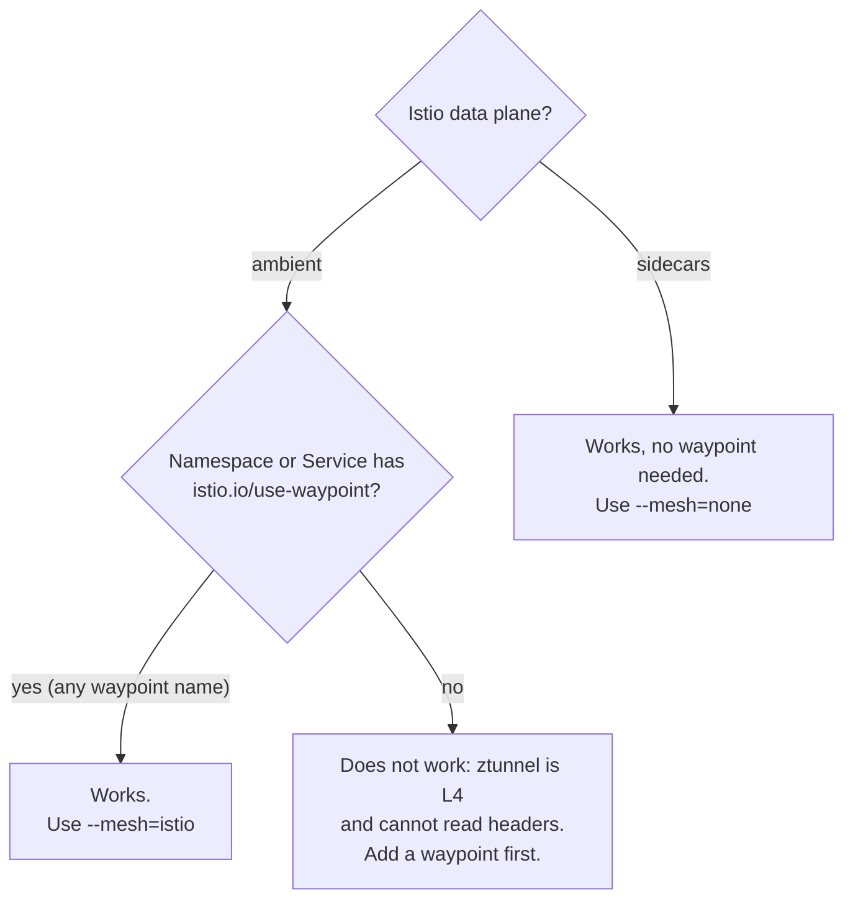
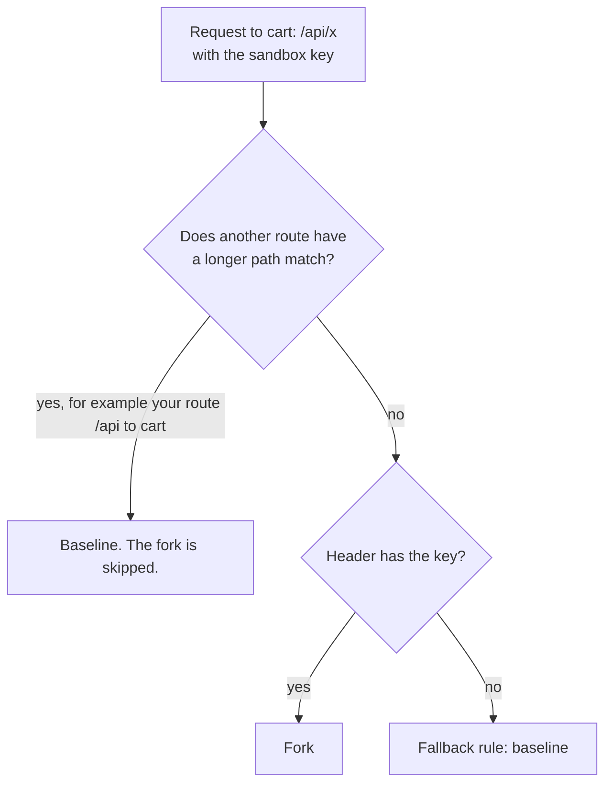
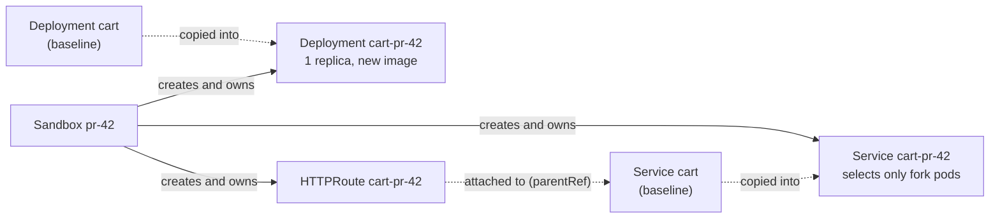
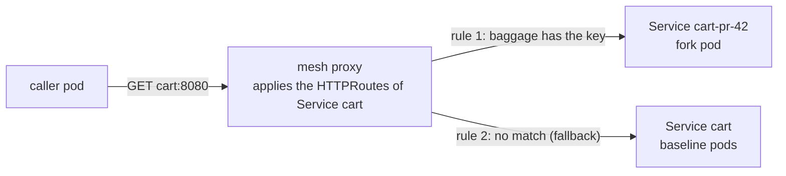

# ashbox

Sandboxes for services on Kubernetes. A sandbox runs changed copies ("forks") of some services next to the normal ones. Requests that carry the sandbox's routing key go to the forks. All other requests go to the normal services, which stay unchanged.

```
caller ──► Service cart ──► mesh reads "baggage: routing-key=4wsdsbw5ewoc"
                              ├── sandbox pr-42's key ──► cart-pr-42 (fork)
                              └── no key              ──► cart       (baseline)
```

With [k8s-tunnel](#local-development-with-k8s-tunnel), a sandbox can also send keyed requests to a service that runs on your laptop.

## Status

Early. These parts work and have tests:

- The `Sandbox` API (`ashbox.dev/v1alpha1`) and its CRD.
- The controller creates, updates and removes forks (Deployment or Rollout baseline), fork Services and HTTPRoutes. It routes `local` entries to k8s-tunnel Services, with a `ReferenceGrant`.
- Status: phases with damping, per-fork reason (for example `CrashLoopBackOff`), conditions `SpecValid` and `RoutesProgrammed` (`--mesh=istio`).
- TTL: expiry date, and deletion when it runs out.
- The controller never takes over an object it did not create.

The header routing was checked by hand on Istio ambient (`deploy/demo`).

The `ashctl` CLI in [k8s-tunnel](https://github.com/ashutosh5786/k8s-tunnel) creates and manages sandboxes.

Not built yet: metrics, prebuilt `ashctl` binaries, and tests against a real API server (envtest).

## Getting started

There are two parts. The cluster side is installed once per cluster, by an administrator. The CLI side is installed by each developer.

| Part | Repository | Who installs it |
|--|--|--|
| ashbox controller | this repository | cluster administrator |
| k8s-tunnel server (only for laptop development) | [k8s-tunnel](https://github.com/ashutosh5786/k8s-tunnel) | cluster administrator |
| `ashctl` CLI | [k8s-tunnel](https://github.com/ashutosh5786/k8s-tunnel) | each developer |

Administrators need `kubectl` and `helm`. Developers need Go 1.27 or later to install `ashctl`.

### Cluster side (once per cluster)

**1. Gateway API CRDs.** Skip this step if the cluster has them.

```bash
kubectl apply --server-side -f https://github.com/kubernetes-sigs/gateway-api/releases/download/v1.7.0/standard-install.yaml
```

**2. A mesh that supports GAMMA.** For example, Istio ambient:

```bash
helm repo add istio https://istio-release.storage.googleapis.com/charts && helm repo update
helm install istio-base istio/base -n istio-system --create-namespace --wait
helm install istiod istio/istiod -n istio-system --set profile=ambient --wait
helm install istio-cni istio/cni -n istio-system --set profile=ambient --wait
helm install ztunnel istio/ztunnel -n istio-system --wait
```

**3. Put each namespace with services to fork in the mesh.** With Istio ambient, this means a label and a waypoint. Change `shop` to your namespace:

```bash
kubectl label namespace shop istio.io/dataplane-mode=ambient istio.io/use-waypoint=waypoint
kubectl apply -f - <<'EOF'
apiVersion: gateway.networking.k8s.io/v1
kind: Gateway
metadata:
  name: waypoint
  namespace: shop
  labels: { istio.io/waypoint-for: all }
spec:
  gatewayClassName: istio-waypoint
  listeners: [{ name: mesh, port: 15008, protocol: HBONE }]
EOF
```

You do not need a catch-all route for each Service. Each sandbox route has a fallback rule that sends requests without the key to the normal Service.

**4. Install the ashbox controller.** The chart uses the published image `docker.io/ashutosh5786/ashbox-controller` (amd64 and arm64):

```bash
git clone https://github.com/ashutosh5786/ashbox && cd ashbox
helm install ashbox deploy/chart/ashbox -n ashbox-system --create-namespace \
  --set controller.mesh=istio \
  --set 'users.subjects[0].kind=Group,users.subjects[0].name=developers,users.subjects[0].apiGroup=rbac.authorization.k8s.io'
```

`users.subjects` gives a group the right to create sandboxes. Use your own group name.

To build the image yourself: `docker buildx build --platform linux/amd64,linux/arm64 -t REGISTRY/ashbox-controller:0.1.0 --push .`, then add `--set image.repository=REGISTRY/ashbox-controller` to `helm install`.

**5. For laptop development, install the k8s-tunnel server.** See "Deploy the server" in the [k8s-tunnel README](https://github.com/ashutosh5786/k8s-tunnel#deploy-the-server).

**Check:** `kubectl get pods -n ashbox-system` shows the controller Running, and `kubectl get crd sandboxes.ashbox.dev` exists.

### Developer side

**1. Install `ashctl`:**

```bash
go install github.com/ashutosh5786/k8s-tunnel/cmd/ashctl@latest
# Installs into $(go env GOPATH)/bin. That folder must be on your PATH.
```

**2. Fork a service with a new image:**

```bash
ashctl sandbox create pr-42 --fork shop/cart=app:REGISTRY/cart:pr-42 \
  --key-from "github.com/acme/shop#42" --wait     # prints the header to use
curl -H "baggage: routing-key=<key>" http://cart.shop:8080/    # reaches the fork
ashctl sandbox get pr-42
ashctl sandbox delete pr-42
```

`--key-from` makes the key stable: the same pull request always gets the same key. See [Routing key](#routing-key).

To keep the sandbox in a file, run `ashctl sandbox generate pr-42`. It writes a commented `sandbox.yaml`. Edit it, then run `ashctl sandbox create -f sandbox.yaml`.

**3. Or run the service on your laptop:**

```bash
ashctl connect
ashctl local shop/cart --port 8080:3000     # your localhost:3000
# It prints the header. Requests with that header for cart now reach your laptop.
ashctl disconnect                           # also deletes the sandbox
```

Your services must forward the `baggage` header on their outgoing calls (OpenTelemetry does this). Then the key also reaches forks deeper in the call chain.

## Runs anywhere

- **Any cluster** that you reach with a kubeconfig: EKS, AKS, GKE, kind, k3s. ashbox uses no cloud SDK.
- **Any mesh** that supports the Gateway API for service meshes (GAMMA): HTTPRoutes attached to a Service. Examples are Istio (ambient with a waypoint, or sidecars), Linkerd and Cilium. ashbox writes plain Gateway API objects. Checks for one mesh only are behind `--mesh` (now `none` or `istio`).
- **Any CPU:** pure Go (`CGO_ENABLED=0`). The image is built for `linux/amd64` and `linux/arm64`.
- **Argo Rollouts are optional.** ashbox reads a Rollout as an unstructured object and copies it into a Deployment.

### Requirements

1. The Gateway API CRDs (`HTTPRoute`, `ReferenceGrant`).
2. A mesh that applies HTTPRoutes attached to Services (GAMMA).
3. Services that forward the `baggage` header on their outgoing calls. OpenTelemetry does this.

## Using an existing Istio install

If the cluster already has Istio, skip the mesh steps and install only the controller. ashbox does not install or change Istio. It only writes Gateway API objects.



Check these before you install:

| Check | Command | Need |
|--|--|--|
| Istio version | `istioctl version` | 1.24 or later for ambient with waypoints. |
| Gateway API CRDs | `kubectl get crd httproutes.gateway.networking.k8s.io -o jsonpath='{.metadata.annotations.gateway\.networking\.k8s\.io/bundle-version}'` | Any v1.x. Do not replace the installed version without asking its owners. |
| Waypoint traffic type | `kubectl get gateway -n shop -o yaml` | `istio.io/waypoint-for` is `service` (default) or `all`. With `workload`, the routes do nothing. |

### Existing routes can hide the fork

Gateway API ranks a path match **above** a header match. So a route of your own with a longer path wins over the sandbox key, and the keyed request goes to the baseline:



Routes of your own that only match `/` are safe. Also look for these:

- **VirtualServices** on a forked Service. Istio does not support a VirtualService and an HTTPRoute for the same host at the same time, and it ignores one of them without a clear error. Move the Service to HTTPRoute first.
- **AuthorizationPolicies that select pods by label.** Fork pods do not have the labels that the Service selects on (for example `app: cart`), so such a policy does not apply to the fork. Policies on the Service, the waypoint or the ServiceAccount still apply. The fork uses the same ServiceAccount.

## How it works



A request then flows like this. The mesh proxy is the waypoint in Istio ambient, or the caller's sidecar:



The controller does these steps for each fork in a sandbox:

1. It copies the baseline Deployment (or Rollout) into `{name}-{sandbox}`, with one replica, the new images, env and patch.
2. It removes the labels that the baseline Services select on from the fork's pods. The baseline Services then never send traffic to the fork.
3. It copies each baseline Service into `{service}-{sandbox}`, which selects only the fork's pods.
4. It attaches an HTTPRoute to each baseline Service port. The route matches the header `baggage` with the regex `(^|.*,)\s*routing-key=<key>\s*([,;].*)?$` and sends the request to the fork Service. The regex is anchored on both sides, so a key never matches a longer key that starts with it. A second rule, with no match, sends all other requests to the baseline Service. Gateway API ranks a rule with a header match above a rule without one, so keyed requests still go to the fork. Without this rule, Istio would answer 404 to requests without the key once a route is attached. A baseline route of your own with more specific rules (paths, headers) still wins for its requests.

Each sandbox owns its own objects through ownerReferences. Deleting a sandbox deletes all of them. Sandboxes never edit shared objects, so many sandboxes can fork the same service at the same time. `Sandbox` is cluster-scoped, because an ownerReference cannot point across namespaces to a namespaced owner.

### Routing key

The routing key is the value in `baggage: routing-key=<key>`. It is **not** the sandbox name. The controller writes it to `status.routingKey`, and it never changes after that. The spec chooses it in one of three ways:

| Spec | Key | After delete and create again |
|--|--|--|
| `keySource: github.com/acme/shop#42` | Derived: 12 characters, `a-z` and `2-7`, from a SHA-256 hash of the source | **Same key**, because the same source always gives the same key |
| `routingKey: cart-pricing` | Exactly this value: 8 to 32 characters, `a-z`, `0-9` and `-` | Same key |
| neither | Derived from the sandbox UID | New key |

For CI, use one `keySource` per pull request. For example, in GitHub Actions: `--key-from "github.com/${{ github.repository }}#${{ github.event.number }}"`. A redeploy of the PR then keeps the same header, so links and test settings stay valid.

The API server enforces the rules with CEL in the CRD:
- `routingKey` and `keySource` cannot be changed, added or removed after creation.
- You cannot set both.
- `metadata.name` is immutable in Kubernetes anyway.

The controller enforces uniqueness. When two live sandboxes have the same key, the older one keeps it. The newer one goes to `Failed` ("routing key ... is already used by sandbox ..."), gets no routes, and checks again every 30 seconds. A sandbox that is being deleted does not hold its key, so you can delete a sandbox and create it again at once.

The key is not a secret. Anyone who can send a request with the header reaches the fork. Do not use the key as access control.

### Status phases

| Phase | Meaning |
|--|--|
| Pending | New sandbox, and not all forks are ready yet (in the first 5 minutes). |
| Ready | All forks are ready. Breaks shorter than 5 minutes do not change this. |
| Degraded | Some forks have not been ready for more than 5 minutes. |
| Failed | No fork has been ready for 5 minutes, or the spec is invalid. |
| Expired | The TTL ran out. The sandbox is deleted. |

A down fork counts as ready again after it is ready for 1 minute. A failed fork keeps its route, so keyed requests to it get a 503. They do not go to the baseline without a warning. Change the periods with `--degraded-after` and `--recovered-after`.

## Local development with k8s-tunnel

k8s-tunnel is an extension of ashbox. It connects a laptop to the cluster:

1. `ashctl connect --expose checkout-ash:8080:3000/http` publishes the laptop's port 3000 as Service `checkout-ash` in the `k8s-tunnel` namespace.
2. A `local` entry in the sandbox points the baseline `checkout` at that Service. ashbox adds an HTTPRoute and a `ReferenceGrant`, which allows the route to reach the other namespace.
3. Keyed requests for `checkout` go to the laptop. Outbound calls from the laptop reach the cluster through `ashctl --hosts`.

See `deploy/examples/sandbox.yaml`.

## Build and test

```bash
make generate   # deep-copy code and CRD, after a change in api/
make test
make build      # bin/ashbox-controller
make cross      # Linux amd64 and arm64
make image      # multi-architecture image
```

## Install

```bash
helm install ashbox deploy/chart/ashbox --namespace ashbox-system --create-namespace
kubectl apply -f deploy/examples/sandbox.yaml
kubectl get sandboxes
```

Helm installs the CRD in `crds/` only on the first install. After a change to the API, apply it yourself: `kubectl apply --server-side -f deploy/chart/ashbox/crds/`.

| Value | Default | Meaning |
|--|--|--|
| `controller.baggageKey` | `routing-key` | Baggage entry that holds the routing key. |
| `controller.mesh` | `none` | `istio` also reports namespaces without a waypoint. |
| `controller.degradedAfter` | `5m` | Time not ready before a fork counts as down. |
| `controller.recoveredAfter` | `1m` | Time ready before a down fork counts as up. |
| `users.subjects` | `[]` | Who may create sandboxes (binds ClusterRole `<release>-user`). |

## Layout

| Path | Contents |
|--|--|
| `api/v1alpha1` | The `Sandbox` type. `zz_generated.deepcopy.go` is generated. |
| `cmd/ashbox-controller` | The controller command. |
| `internal/controller` | The reconcile loop. |
| `internal/fork` | Fork Deployment and Service rendering. |
| `internal/route` | HTTPRoute, ReferenceGrant and the key regex. |
| `internal/status` | Phase computation with damping. |
| `internal/ttl` | TTL parsing (`4h`, `14d`). |
| `internal/names` | Child names, labels and routing key. |
| `deploy/chart/ashbox` | Helm chart. The CRD in `crds/` is generated. |
